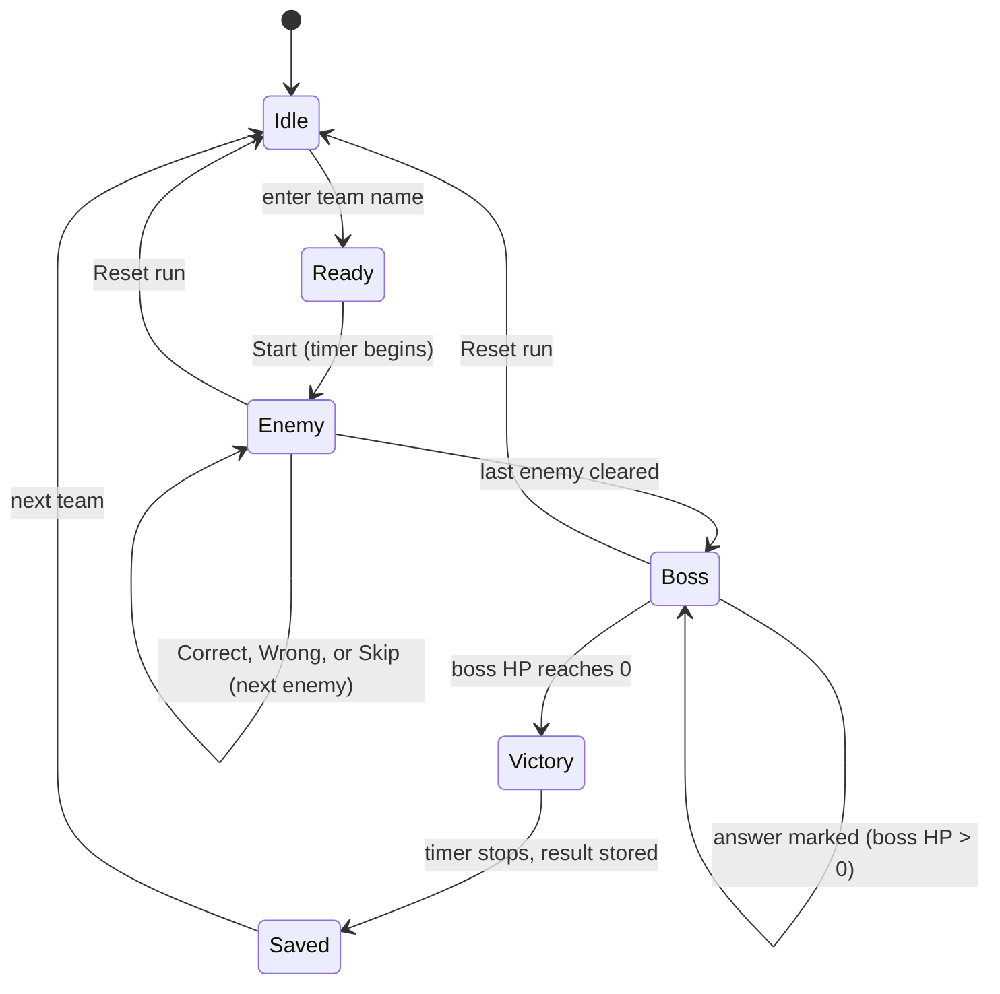

# Tech Quest Treasure Hunt: Technical Proposal

| | |
|---|---|
| **Event** | Tech Quest, run by the BCA department for pre-university (PU) students |
| **Document** | Technical proposal for the "Cavern of Code" dungeon-crawl application |
| **Version** | 1.0 (draft for review) |
| **Date** | October 20, 2026 |
| **Prepared for** | BCA department organising committee |
| **Status** | Awaiting decisions listed in Section 14 |

---

## 1. Executive summary

Tech Quest needs one activity that makes computer science feel approachable and fun to about 300 PU students from every stream. This proposal describes **Cavern of Code**, a 6-minute, Skyrim-style dungeon crawl played by teams of 5 on a single projector screen. A knight descends through four themed zones, each enemy is a quick logic question, a boss closes the run, and the chest at the end reveals the next clue in the treasure hunt. Teams are ranked on a live leaderboard by total time.

The application is deliberately small. It is a browser-based web app that runs on **one shared computer**, with two windows: a projector view for players and a control panel for the control head. There is no backend, no database server, and no internet dependency. Results are saved locally after every action, so a crash or a lost connection cannot lose the leaderboard.

The main challenge is not technical. It is **throughput**: 60 teams at 6 minutes each is about 7 hours on one machine once changeovers are counted. This proposal recommends a shorter default run, a configurable length, and an optional qualifier round so the event fits its time slot.

**What we are asking for:**

1. Approval of the scope and architecture in this document.
2. Decisions on the open items in Section 14, especially the number of screens and the run length.
3. Named owners for development, question writing, and artwork (Section 12).

---

## 2. Background and goals

### 2.1 Event context

| Item | Detail |
|---|---|
| Organiser | BCA department |
| Audience | About 300 PU students in about 60 teams of 5, from any stream (commerce students should feel at home) |
| Prior knowledge | None assumed |
| Format | One projector screen, no player keyboards, one control head running the session |
| Prizes | Top 10 teams advance, top 3 win prizes |

### 2.2 Goals

1. **Attract:** show students that computer science is approachable and fun, so they consider BCA.
2. **Include:** every question is solvable by logic or common sense, so no stream has an advantage.
3. **Compete fairly:** a trustworthy leaderboard that produces a clear top 10.
4. **Run reliably:** no single failure (crash, network, projector) can stop or invalidate the event.

### 2.3 Success measures

| Measure | Target (proposed) |
|---|---|
| Teams that complete a run | At least 95% |
| Average run time (including changeover) | At or under the planned slot length |
| Runs lost or corrupted by technical faults | 0 |
| Students who say computer science felt approachable (exit poll) | At least 80% |
| BCA information requests or sign-ups collected at the event | Recorded for follow-up |

---

## 3. Scope

### 3.1 In scope

- Dungeon view (projector), control panel, live leaderboard, and victory screen
- Question engine with difficulty tags, random variants, and answer keys
- Scoring with penalties, tie-breaks, and a boss fight with chosen difficulty
- Local persistence, export, undo, and recovery
- Content: four zone question sets plus a boss pool, with variants
- Pixel-art assets, sound effects (optional), and the printed backup kit

### 3.2 Out of scope (for this version)

- Player-facing input devices (players never touch a keyboard)
- Online play, user accounts, or any cloud service
- Multi-machine synchronisation (listed as an optional extension, Section 15)
- Automatic answer checking (the control head marks answers)

### 3.3 Assumptions

1. A single laptop or desktop with a projector or external display, and a keyboard and mouse for the control head.
2. A modern browser (current Chrome, Edge, or Firefox) on that machine.
3. The venue may have no reliable internet, so the app must work fully offline.
4. The control head hears the spoken answer and taps correct or wrong; the app does not listen to players.

---

## 4. Requirements

### 4.1 Functional requirements

| ID | Requirement | Priority |
|---|---|---|
| F1 | Control head enters a team name and presses Start; the timer begins when the first enemy appears | Must |
| F2 | Each enemy shows one question on the projector with a sprite and a difficulty-based hit animation | Must |
| F3 | Control head marks Correct or Wrong; Correct defeats the enemy and drops a letter or digit; Wrong adds 10 seconds and the knight takes a hit | Must |
| F4 | After a wrong answer the next enemy appears after a short pause, so a team is never stuck | Must |
| F5 | Control head can Skip an enemy (+20 seconds) | Must |
| F6 | Enemies appear in the same order for every team; each enemy has 2 or 3 equal-difficulty variants picked per team | Must |
| F7 | Boss "The Summarizer" has 100 HP; the team chooses easy, medium, or hard per question; damage is 20, 30, or 50 | Must |
| F8 | Boss falls at 0 HP after 2 to 5 correct answers; wrong answers add 10 seconds | Must |
| F9 | Chest opens, the next clue is shown, the timer stops, and the result is saved | Must |
| F10 | Live leaderboard shows rank, team name, and total time, with the top 10 highlighted | Must |
| F11 | Ties on total time are broken by fewer wrong answers | Must |
| F12 | Control panel offers Reset run, Add time, and Undo last action | Must |
| F13 | Questions and variants live in one data file that can be edited without touching app code | Must |
| F14 | Control panel shows the current question and its answer key (never shown on the projector) | Must |
| F15 | Export results to CSV and JSON; import a saved backup | Should |
| F16 | Optional sound effects and a mute control | Could |
| F17 | Practice mode so volunteers can try the game without writing to the leaderboard | Should |

### 4.2 Non-functional requirements

| ID | Requirement |
|---|---|
| N1 | **Offline:** runs with no internet; all assets bundled |
| N2 | **Durable:** state saved after every action; recovery after a browser crash restores the in-progress run |
| N3 | **Readable:** large text legible from the back of the room (see Section 8.4) |
| N4 | **Fast:** control head actions reflect on the projector within 100 ms |
| N5 | **Simple to operate:** one person, mouse or keyboard shortcuts, no training beyond a 10-minute walkthrough |
| N6 | **Editable content:** a non-developer can fix a typo or swap a question in the data file |
| N7 | **Fair timing:** timer uses a monotonic clock, not wall-clock time, so system clock changes cannot affect results |

---

## 5. System architecture

### 5.1 Overview

Everything runs on one computer in one browser. Two windows (projector and control) are the same web app opened at two addresses and kept in sync in-browser.

```
        Players (team of 5)                    Control head
              |  ^                                  |
   answer     |  | watch                            | taps correct / wrong
   aloud ---------+----------------------------->    v
                  |                          +----------------+
        +---------+-----------+              | Control window |
        |  Projector window   |              | (control.html) |
        |  (display.html)     |              +-------+--------+
        +---------^-----------+                      |
                  | state updates                    | commands
        +---------+----------------------------------v------+
        |                    Game engine                    |
        |   state machine, timer, scoring, boss HP          |
        +-------+------------------------------------+------+
                |                                    |
        +-------v--------+                  +--------v---------+
        | questions.json |                  |  Local storage   |
        | (read-only)    |                  | (results, log)   |
        +----------------+                  +------------------+
```

### 5.2 Components

| Component | Responsibility |
|---|---|
| **Projector window** (`display.html`) | Renders the dungeon, enemy, question, timer, hearts, leaderboard, and victory screen. Read-only: it never accepts input |
| **Control window** (`control.html`) | The only place input happens. Shows the current question, answer key, and all controls |
| **Game engine** | A single module holding the run state machine, timer, scoring rules, and boss logic. Pure logic with no DOM code, so it can be unit-tested |
| **Content loader** | Validates and loads `questions.json` at startup; fails loudly with a readable error if the file is malformed |
| **Persistence layer** | Appends every action to an event log and saves snapshots to local storage; handles export, import, and recovery |

### 5.3 Window synchronisation

The two windows live on the same origin in the same browser, so they communicate through the browser's `BroadcastChannel` API, with `localStorage` as the durable record. The control window is the **single writer**: it sends commands to the engine, the engine produces a new state, and both windows render from that state. The projector window never mutates state.

If the projector window is reloaded mid-run, it reads the latest snapshot from local storage and resumes exactly where it was.

> **Hosting note:** Open the app through a tiny local web server (for example `python -m http.server` or a one-file static server) rather than directly from the file system. Browsers can isolate file-based pages from each other, which breaks window sync. A localhost address avoids this.

### 5.4 Technology stack

| Layer | Choice | Reason |
|---|---|---|
| App | HTML, CSS, and vanilla JavaScript (ES modules) | No build step, no dependencies to break on event day, easy for volunteers to read |
| Rendering | DOM and CSS animation; `<canvas>` only if sprite effects need it | Pixel art with CSS `image-rendering: pixelated` is simple and crisp |
| State | Plain JS state machine with an append-only event log | Easy to test, undo, and replay |
| Sync | `BroadcastChannel` plus `localStorage` | Built into browsers; works offline |
| Content | JSON file validated at load | Editable without code changes |
| Tests | A small test runner for the engine (for example Node's built-in test runner) | Scoring and boss rules are the highest-risk logic |
| Hosting | Local static server on the shared computer | Offline, zero cost |

A framework (React, Vue) is not recommended: the app is two screens and a state machine, and every added dependency is another thing that can fail without internet.

---

## 6. Game logic

### 6.1 Run states



### 6.2 Control commands

| Command | Effect | Shortcut (proposed) |
|---|---|---|
| Start | Begins the run for the queued team | `Space` |
| Correct | Defeats the enemy (or damages the boss) | `C` |
| Wrong | +10 s, knight takes a hit, next enemy after a short pause | `W` |
| Skip enemy | +20 s, next enemy | `S` |
| Boss difficulty | Selects easy, medium, or hard for the next boss question | `1`, `2`, `3` |
| Undo | Reverses the last action, including its time penalty | `Z` |
| Add time | Applies a manual penalty with a reason | button only |
| Reset run | Discards the current run (asks for confirmation) | button only |

Destructive actions (Reset, Add time) have no shortcut and require confirmation, so a stray key press cannot ruin a run.

### 6.3 Timing and scoring

| Rule | Detail |
|---|---|
| Timer starts | When the first enemy appears |
| Timer stops | When the chest opens |
| Total time | Elapsed time plus all penalties |
| Wrong answer | +10 seconds |
| Skipped enemy | +20 seconds |
| Rank | Lowest total time first |
| Tie-break 1 | Fewer wrong answers |
| Tie-break 2 (proposed) | Fewer skips, then the earlier finish |

The timer uses `performance.now()` (a monotonic clock). Penalties are stored as separate line items, so the leaderboard can show "elapsed" and "penalties" and a dispute can be settled from the event log.

### 6.4 Enemy flow

1. The engine picks one variant for the enemy (see Section 9.2) and sends it to both windows.
2. The projector shows the sprite and question; the control window shows the question and the answer key.
3. The team discusses and one person calls the answer aloud. **The first clearly stated answer counts**; changing it afterwards is not allowed.
4. The control head taps Correct or Wrong. The engine applies the result and advances.

Difficulty tags set the **size of the hit animation** (small slash for easy, big punch for hard). In the four zones, one correct answer always defeats the enemy.

### 6.5 Boss fight

| Item | Value |
|---|---|
| Boss | The Summarizer |
| HP | 100 |
| Damage | Easy 20, Medium 30, Hard 50 |
| Questions to win | 2 (two hard) up to 5 (five easy) |
| Wrong answer | +10 s, no damage |
| Question pool | Mixed recap of all four domains |

For each boss question the team picks a difficulty; the engine draws a question of that difficulty that has not been used in this run. Hard ends the fight faster but is riskier, which gives the final round a real decision. HP and damage values are starting values to tune in the dry run.

### 6.6 Hearts

The projector shows three hearts. To keep the rule "nobody is ever stuck", hearts are **cosmetic**: each wrong answer removes one, and after the third they refill with a short "knight recovers" animation. There is no game-over state.

### 6.7 Undo and recovery

- Every action is appended to an event log with a timestamp and the resulting state.
- **Undo** removes the last event and recomputes state by replaying the log.
- After a crash or accidental reload, the app finds an unfinished run in storage and offers to **Resume** or **Discard**.

---

## 7. Data design

### 7.1 Question file (`questions.json`)

One file holds all content. The engine validates it at load.

```json
{
  "meta": { "version": 1, "title": "Cavern of Code" },
  "rules": {
    "wrongPenaltySec": 10,
    "skipPenaltySec": 20,
    "damage": { "easy": 20, "medium": 30, "hard": 50 },
    "bossHp": 100
  },
  "zones": [
    { "id": "crypt", "name": "Crypt of Cipher", "domain": "data", "accent": "#5b8def" }
  ],
  "enemies": [
    {
      "id": "z1-e1",
      "zone": "crypt",
      "order": 1,
      "difficulty": "easy",
      "sprite": "skeleton",
      "variants": [
        {
          "id": "z1-e1-a",
          "prompt": "Shift every letter back by 3 to decode: FDW",
          "type": "word",
          "answer": "CAT"
        },
        {
          "id": "z1-e1-b",
          "prompt": "Shift every letter back by 3 to decode: GRJ",
          "type": "word",
          "answer": "DOG"
        }
      ]
    }
  ],
  "boss": {
    "name": "The Summarizer",
    "sprite": "summarizer",
    "pool": {
      "easy":   [ { "id": "b-e-1", "domain": "security", "prompt": "...", "type": "choice", "choices": ["A", "B", "C"], "answer": "B" } ],
      "medium": [],
      "hard":   []
    }
  },
  "clue": { "text": "The next clue goes here", "reveal": "chest" }
}
```

**Field rules**

| Field | Rule |
|---|---|
| `type` | `word`, `letter`, or `choice`, so the control head can mark in one tap |
| `answer` | Stored as the single correct value; shown only on the control panel |
| `variants` | 2 or 3 per enemy, equal difficulty, different content |
| `order` | Position in the corridor; difficulty rises within each zone and across the run |
| `image` (optional) | Path to a bundled image for the Spot AI Imagery questions |

**Startup validation** checks that every enemy has at least 2 variants, every `answer` exists (and, for `choice`, is one of `choices`), every referenced image file exists, and the boss pool has enough questions per difficulty (at least 5 each, 8 recommended).

### 7.2 Run record

```json
{
  "runId": "2026-10-20T10:42:07Z-team-07",
  "team": "Byte Knights",
  "slot": 7,
  "startedAt": "2026-10-20T10:42:07Z",
  "status": "saved",
  "elapsedMs": 241300,
  "penaltyMs": 30000,
  "totalMs": 271300,
  "wrongCount": 2,
  "skipCount": 1,
  "variantsUsed": ["z1-e1-b", "z1-e2-a"],
  "events": [ { "t": 12400, "type": "correct", "enemy": "z1-e1" } ]
}
```

### 7.3 Persistence

| Mechanism | Purpose |
|---|---|
| `localStorage` snapshot after every action | Crash recovery |
| Append-only event log per run | Undo, replay, and dispute resolution |
| Auto-download of a CSV backup every N runs (proposed N = 5) | Protection against browser data loss |
| Manual Export and Import buttons | Moving results between machines or restoring a backup |
| Printed leaderboard at each break | Last-resort paper record |

---

## 8. User interface

### 8.1 Screens

| Screen | Audience | Content |
|---|---|---|
| Dungeon view | Players (projector) | Cave background, pixel-art knight, current enemy sprite, question, timer, three hearts, zone name |
| Control panel | Control head only | Team name entry, Start, Correct, Wrong, Skip, boss difficulty, Undo, Add time, Reset, question and answer key, queue of next teams |
| Leaderboard | Players, between runs or in a corner | Live rank, team name, total time; top 10 highlighted |
| Victory screen | Players | Chest opening animation, next clue, final time and rank |

### 8.2 Control panel layout (proposed)

```
+------------------------------------------------------+
| Team: Byte Knights        Slot 7 / 60     Timer 02:41 |
+------------------------------------------------------+
| Zone 3, enemy 2 of 3 (medium)                         |
| Q:  Which message is the scam? (A, B, or C)           |
| ANSWER KEY:  B                                        |
+------------------------------------------------------+
|  [ CORRECT (C) ]   [ WRONG (W) ]   [ SKIP (S) ]       |
|  [ Undo (Z) ]   [ Add time ]   [ Reset run ]          |
+------------------------------------------------------+
| Up next: 1. Code Crew   2. Pixel Pirates   3. ...     |
+------------------------------------------------------+
```

Correct and Wrong are the two largest targets and are visually distinct (shape as well as colour, for colour-blind operators).

### 8.3 Look and feel

- Dark cave with torchlight glow; each zone has its own accent colour.
- One shared timer and one "enemy defeated" animation across all zones, so the run feels like a single descent.
- Short, snappy animations (under 700 ms) so the run does not lose time to effects.

### 8.4 Readability

| Item | Guideline |
|---|---|
| Question text | At least 40 px on a 1080p projector; maximum about 20 words |
| Timer | At least 64 px, high contrast |
| Contrast | Light text on dark background, at least 7:1 |
| Answer choices | Large labels (A, B, C), never small print |
| Testing | Check legibility from the back row of the real room before the event |

---

## 9. Content plan

### 9.1 Structure of a run

| Zone | Domain | Enemies | Example question types |
|---|---|---|---|
| 1. Crypt of Cipher | Data: cipher, storage, types | 3 | Decode a shift-cipher word; binary to a letter with a wall chart; pick the data type for a price, name, or yes/no |
| 2. Forge of Logic | Programming | 3 | What does this 3-line pseudocode print; order shuffled steps; spot the bug |
| 3. Gate of Shields | Cybersecurity | 3 | Spot the scam among three UPI or parcel messages; strongest of four passwords; what to do when asked for an OTP |
| 4. Heart of the Cave | AI | 3 | Which image is AI-made; pick the prompt that gets the described result; which everyday tools use AI |
| Boss: The Summarizer | All four | 2 to 5 | Mixed recap; team picks easy, medium, or hard |

The full run is 12 enemies plus the boss, about 6 minutes at 15 to 20 seconds per enemy. See Section 10 for why a shorter default is recommended.

### 9.2 Variants

Each enemy has 2 or 3 variants of equal difficulty. To keep exposure even across teams, variant selection should be **balanced random**: shuffle the variants in cycles so each appears about equally often over the day, rather than pure random selection (which can cluster by chance). Equal difficulty is verified in the dry run by comparing solve times across variants and replacing outliers.

### 9.3 Question-writing rules

1. Answerable by logic or common sense; no prior CS knowledge.
2. Single word, letter, or choice, markable in one tap.
3. Difficulty rises within each zone and across the run.
4. Zone 1 must work as a cold start, since every team begins there.
5. No trick wording; the challenge is thinking, not decoding the sentence.
6. Inclusive examples: Indian context for UPI, OTP, and parcel scams; avoid jargon.
7. Every question has an answer key and, where useful, a one-line explanation the control head can read aloud.

### 9.4 Content volume

| Item | Count |
|---|---|
| Enemy slots | 12 (or 8 to 9 in the shortened run) |
| Variants per enemy | 2 to 3, so 24 to 36 questions |
| Boss pool | 8 per difficulty recommended, so 24 questions (minimum 15) |
| Image pairs (AI vs real) | At least 3 pairs, all prepared in advance |
| Total questions to write and review | About 50 to 60 |

### 9.5 Sample questions (illustrative)

| Zone | Prompt | Type | Answer |
|---|---|---|---|
| 1, easy | Shift every letter back by 3 to decode: FDW | word | CAT |
| 1, easy | Using the wall chart, which letter is 01000010? | letter | B |
| 1, medium | What type of data is best for a price? (Number, Text, Yes/No) | choice | Number |
| 2, easy | x = 2. Repeat 3 times: add 2 to x. What does x equal? | word | 8 |
| 3, medium | Which password is strongest? | choice | The long mix of words, numbers, and symbols |
| 3, medium | A caller says they are from your bank and asks for your OTP. What do you do? | choice | Hang up and call the bank's official number |
| 4, easy | Which of these uses AI? (Pocket calculator, Voice assistant, Light switch) | choice | Voice assistant |

---

## 10. Throughput and scheduling

### 10.1 The constraint

One computer and one screen means teams play one at a time. Assuming about 1 minute between teams to swap and queue the next name:

| Run length | Per team (with changeover) | 60 teams |
|---|---|---|
| 6 min (full, 12 enemies plus boss) | 7 min | About 7 hours |
| 4 min (8 to 9 enemies plus 2-question boss) | 5 min | About 5 hours |
| 3 min (8 enemies plus short boss) | 4 min | About 4 hours |

### 10.2 Recommendation

1. **Make the run length configurable** in the data file (enemies per zone, boss length), so it can be tuned after the dry run without code changes.
2. **Default to a shortened run** (2 enemies per zone plus a 2 to 3 question boss), targeting about 4 minutes.
3. **Run as a booth with scheduled slots** over the whole event, with the leaderboard visible between runs, rather than one long block that holds everyone in a queue.
4. **Consider a qualifier** (a quick paper or verbal round) so only 20 to 30 teams play on the screen. At 4 minutes plus changeover, 30 teams take about 2.5 hours, and the dungeon becomes a reward rather than a bottleneck.
5. **Ask whether a second computer is possible.** Even one extra laptop running the same app, with exports merged into one leaderboard, roughly halves the time (see Section 15).

### 10.3 Queue management

The control panel holds a queue of upcoming team names (pasted in advance from the registration list), so changeover is: press Save, confirm the next team name, press Start. A floor volunteer calls teams two slots ahead so there is no gap.

---

## 11. Fairness and integrity

The leaderboard decides who advances, so its credibility matters.

| Risk | Mitigation |
|---|---|
| Later teams overhear answers | 2 or 3 balanced-random variants per enemy; hold waiting teams out of earshot; same-order corridor but different content |
| Control head timing noise in marking | One consistent control head per session; "first clear answer counts" rule; answer key on screen so marking is a lookup, not a judgement |
| Mis-tap changes a result | Undo (`Z`) with the event log; destructive actions need confirmation |
| Variants differ in difficulty | Verify in the dry run by comparing solve times; replace outliers |
| Disputed result | Event log shows every action and timestamp; printed leaderboard at breaks |
| Clock changes | Monotonic timer; penalties stored as separate items |
| Team stalls on one enemy | Control head skip (+20 s) |

---

## 12. Team and responsibilities

| Role | Responsibility | Owner |
|---|---|---|
| Project lead | Decisions, schedule, sign-off | TBD |
| Developer(s) | Engine, windows, persistence, tests | TBD |
| Content lead | Question set, variants, answer keys, review | TBD |
| Artwork and sound | Sprites, backgrounds, chest and boss assets | TBD |
| Control head(s) | Run the sessions; trained in the dry run | TBD |
| Floor manager | Queue, holding area, keeping teams out of earshot | TBD |
| Prizes and clue | Final clue, prize logistics, top-10 follow-up | TBD |

Asset licensing: use original art or openly licensed pixel-art packs, and record each asset's licence in an `ASSETS.md` file.

---

## 13. Testing and rollout

### 13.1 Test plan

| Stage | What is tested | How |
|---|---|---|
| Unit | Scoring, penalties, boss HP, tie-break, undo replay, variant balancing | Automated tests on the game engine |
| Content validation | Schema, answer keys, image paths, variant counts | Run automatically at app load and in a pre-event check script |
| Integration | Two-window sync, reload recovery, local storage save and restore | Manual checklist |
| Dry run 1 | Timing, readability, question difficulty | Small group of 5 to 10 students or staff |
| Dry run 2 | Full event rehearsal: queue, changeovers, leaderboard, backup kit | 5 to 8 mock teams with the real room and projector |
| Failure drills | Browser crash mid-run, projector unplugged, power loss | Deliberately trigger each and confirm recovery |

### 13.2 Acceptance criteria

1. A full run completes start to chest with correct timing and penalties.
2. A browser crash mid-run can be resumed with no lost data.
3. Undo restores the previous state exactly, including time.
4. The leaderboard ranks correctly, including tie-breaks.
5. The dry-run average matches the planned run length within 30 seconds.
6. Text is legible from the back row of the actual room.

### 13.3 Event-day checklist

- [ ] Laptop charged and on mains power, with a spare charger
- [ ] Local server started; both windows open and projector fullscreen
- [ ] Browser zoom, display resolution, and sound checked
- [ ] Practice-mode run completed
- [ ] Team queue loaded
- [ ] Printed backup question set and a manual stopwatch at the control table
- [ ] USB drive with a copy of the app and latest results backup
- [ ] Holding area set up away from the screen
- [ ] Leaderboard CSV exported at every break

---

## 14. Risks and open decisions

### 14.1 Risks

| Risk | Likelihood | Impact | Mitigation |
|---|---|---|---|
| Throughput: 60 teams do not fit on one screen | High | High | Shortened run, scheduled slots, optional qualifier, or a second computer |
| Answers overheard | Medium | High | Variants, holding area, balanced selection |
| Projector or computer failure | Low | High | Offline app, USB copy, printed backup set, manual stopwatch |
| Browser data lost | Low | High | Auto-saved CSV backups, printed leaderboard, export at breaks |
| Run exceeds target length | Medium | Medium | Configurable enemy counts; tune after the dry run |
| Image questions not ready | Medium | Medium | Assign an owner; source real and AI-made image pairs early |
| Unequal variant difficulty | Medium | Medium | Verify in dry run; replace outliers |
| Content errors in answer keys | Medium | High | Two-person review; validation script; dry-run check |

### 14.2 Decisions needed

| # | Decision | Recommendation |
|---|---|---|
| 1 | Number of screens and computers running at once | One computer is supported; ask for a second to halve the time |
| 2 | Run length | Shortened run (about 4 minutes), configurable |
| 3 | Qualifier round before the dungeon | Recommended if the event window is under 5 hours |
| 4 | What the top 10 do next: final round or direct prizes for the top 3 | A short final round on the big screen gives the event a climax |
| 5 | Damage design: easy 20, medium 30, hard 50, boss 100 HP | Accept as the starting values; tune in the dry run |
| 6 | Hearts: cosmetic with refill (as proposed) or a different rule | Cosmetic, to keep "nobody is ever stuck" |
| 7 | Who prepares the AI image pairs and prompting challenge options | Assign a named owner this week |
| 8 | What the chest clue says | Content lead to propose |
| 9 | Completion moment for teams outside the top 10 | A "you cleared the cavern" screen and a BCA information point at the exit |

---

## 15. Optional extensions

| Extension | Benefit | Cost |
|---|---|---|
| **Phone control panel** over the local network via a small WebSocket server | Control head can stand near the players | Adds a tiny Node server and one more thing to fail |
| **Second station** running the same app, with results merged by import | About half the total time | A second computer, projector, and control head |
| **Final-round mode** for the top 10 on the big screen | A clear climax and an engaged audience | Extra questions and a short build |
| **Participation badge** printed or displayed for every team | Every student leaves with a positive moment | Small design and print effort |
| **Spectator view** (leaderboard on a second display) | Keeps waiting students engaged | An extra display |

---

## 16. Timeline

The event date was not given, so milestones are shown relative to the event (E).

| When | Milestone |
|---|---|
| E minus 5 weeks | Proposal approved; open decisions closed; owners named |
| E minus 4 weeks | Question set (first draft) and asset list complete; engine and control panel skeleton built |
| E minus 3 weeks | Dungeon view, leaderboard, persistence, and undo built; first content loaded |
| E minus 2 weeks | Dry run 1; questions tuned; artwork integrated; image questions finalised |
| E minus 1 week | Dry run 2 (full rehearsal in the real room); failure drills; backup kit prepared |
| E minus 2 days | Content freeze; final answer-key review; USB copies made |
| Event day | Setup, practice run, event, exports at every break |
| E plus 1 week | Results published; feedback and BCA follow-up reviewed |

---

## 17. Appendix: reference

### 17.1 Glossary

| Term | Meaning |
|---|---|
| Control head | The person who runs the session and marks answers |
| Run | One team's full pass from the first enemy to the chest |
| Variant | One of 2 or 3 equal-difficulty versions of an enemy's question |
| Penalty | Seconds added to a team's time for a wrong answer, skip, or manual adjustment |
| Event log | The append-only record of every action in a run |

### 17.2 Proposed project structure

```
tech-quest/
  display.html          projector window
  control.html          control window
  css/                  styles and zone themes
  js/
    engine.js           state machine, scoring, boss logic
    content.js          loads and validates questions.json
    storage.js          event log, snapshots, export, import
    sync.js             BroadcastChannel wrapper
  data/
    questions.json      all questions and variants
  assets/               sprites, backgrounds, sounds, image pairs
  tests/                engine tests
  ASSETS.md             licences for every asset
  README.md             how to run and operate
```
